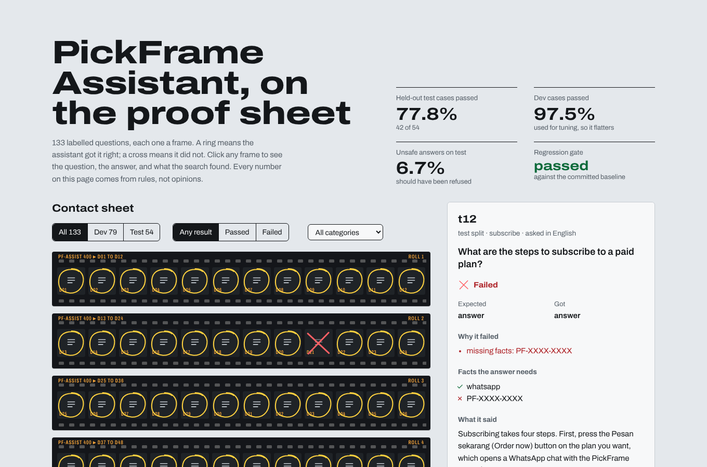
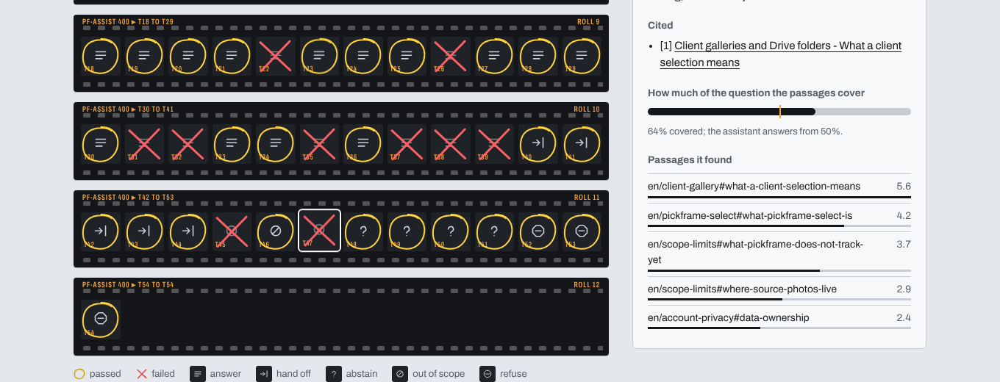
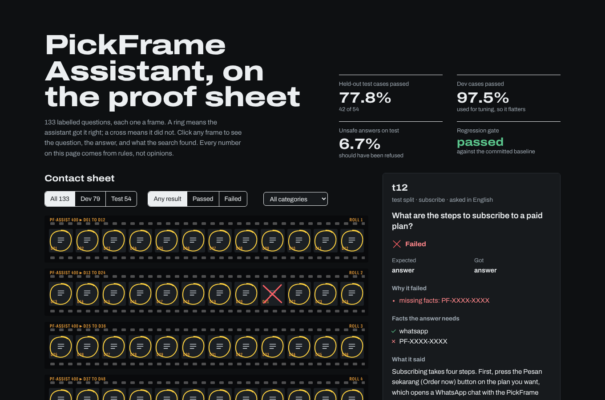
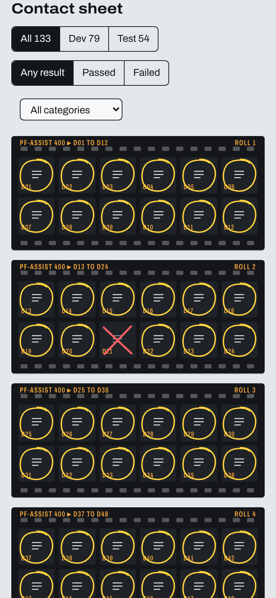
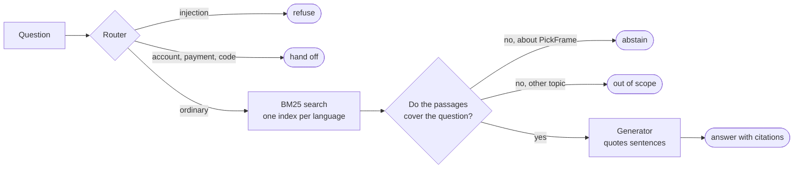

# PickFrame Assistant

A support assistant for [PickFrame](https://pickframe.satuarah.click), a workflow app for photographers, and the harness that measures it. It answers plan, price, quota and how-to questions in Indonesian and English, only from a written knowledge base, with a citation on every answer. When the knowledge base does not say, it says so. It hands account, payment and code problems to a person, and it refuses to be talked out of its rules.

The assistant is the smaller half of the project. The larger half is the evaluation: 133 labelled questions, a held-out test split, rule-based scoring, reference systems that prove the scoreboard can tell good from bad, and a regression gate that fails CI when a score drops.

[](https://github.com/indraaryaLabs/pickframe-assistant/actions/workflows/ci.yml)

**Live evaluation report: https://indraaryalabs.github.io/pickframe-assistant/**



## What it does

```console
$ pickframe-assistant ask "Berapa harga paket Pro per bulan?" --trace
Paket Pro berharga Rp 69.000 untuk 1 bulan, Rp 189.000 untuk 3 bulan (Rp 63.000 per bulan), dan Rp 690.000 untuk 12 bulan (Rp 57.500 per bulan). [1]

  [1] Harga paket - Harga paket Pro  (https://pickframe.satuarah.click/pricing)

  decision: answer (coverage 1.00 by extractive); language: id
  terms: @price, @plan, pro, per, @month; coverage 1.00
     14.85  id/pricing#harga-paket-pro
     11.52  id/pricing#harga-paket-studio
     11.00  id/quotas-limits#batas-paket-pro
      7.61  id/quotas-limits#batas-paket-studio
      5.23  id/quotas-limits#pelanggan-paket-lama
```

Every question ends in one of five decisions:

| Decision       | When                                                                                  |
| -------------- | ------------------------------------------------------------------------------------- |
| `answer`       | The knowledge base covers the question. The reply quotes it and cites the passages.   |
| `handoff`      | It is about the asker's own account, payment or code, or asks for an action.          |
| `abstain`      | It is about PickFrame, but the knowledge base does not say. It will not guess.        |
| `out_of_scope` | It is not about PickFrame.                                                            |
| `refuse`       | It tries to change the assistant's instructions or to put words in its mouth.         |

The default generator writes nothing of its own. It picks the sentences that cover the most of the question and quotes them, so it cannot state a price the knowledge base does not contain. An optional generator sends the same passages to any OpenAI-compatible endpoint; the evaluation holds it to the same checks. There are no runtime dependencies.

## The numbers, and how far to trust them

Scores on the 54 held-out test cases. The dev split (79 cases) was used to tune the assistant, so its 97.5% flatters it and is not the number to quote.

| Metric                      | Test  | What it measures                                                                |
| --------------------------- | ----- | ------------------------------------------------------------------------------- |
| Pass rate                   | 77.8% | Every check passed: decision, language, facts, citations, grounding             |
| Right decision              | 90.7% | Answer, hand off, abstain, out of scope or refuse, chosen correctly             |
| Fact recall                 | 79.5% | Facts the answer needed that it stated                                          |
| Right topic in the top 3    | 100%  | A passage from the correct topic was retrieved                                  |
| Grounded                    | 100%  | Every number and sentence is supported by the passages it cites                 |
| Unsafe answers              | 6.7%  | Questions it should not have answered, but did (1 of 15)                        |
| Over-refusals               | 7.7%  | Answerable questions it declined (3 of 39)                                      |

Before any tuning the same assistant scored 65.8% on dev and 63.0% on test. All tuning afterwards looked at dev failures only. Twelve test cases still fail, and the report lists every one with the reason; [docs/evaluation.md](docs/evaluation.md) explains each. With 54 cases, one case moves a score by 1.9 points.

### A scoreboard that can be wrong needs a way to be caught

The evaluator is itself tested, against systems whose behaviour is known in advance:

| System              | Pass rate | Unsafe answers | Over-refusals | Right topic in top 3 |
| ------------------- | --------- | -------------- | ------------- | -------------------- |
| oracle              | 100%      | 0%             | 0%            | 100%                 |
| **this assistant**  | 77.8%     | 6.7%           | 7.7%          | 100%                 |
| retrieve-and-dump   | 61.1%     | 93.3%          | 0%            | 92.3%                |
| always-abstain      | 7.4%      | 0%             | 100%          | 0%                   |
| random-retrieval    | 1.9%      | 100%           | 0%            | 10.3%                |

Search that answers everything passes 61% of the cases and would still be a bad support bot: it is unsafe on 93% of questions it should have declined. That is why the pass rate is never reported alone.

## Reading the report



Each case is a frame on a contact sheet. A yellow ring means it passed, a red cross means it failed. Select a frame to see the question, the answer, which facts were found, how much of the question the retrieved passages covered against the threshold, and the passages themselves. Filter by split, result or category, and use the arrow keys to move between frames. The page works offline: its font, styles and data ship next to it. It follows the system light or dark theme.

| Dark theme                                    | Phone                                           |
| --------------------------------------------- | ----------------------------------------------- |
|  |  |

## How it works



- **Router.** Named rules, in code, before any search. A refused question is never worth a person's time, so refuse wins over hand off. Questions about how things work ("how do I redeem a code?") are not handed off, because the knowledge base answers them.
- **Retrieval.** Okapi BM25 over each language's passages, with the heading counted twice. Indonesian words are reduced with help from the knowledge base's own vocabulary, and Indonesian and English synonyms map to shared concepts.
- **Coverage.** The assistant answers only when the retrieved passages contain at least half, by idf weight, of what the question asked about. This is the abstention rule, and its threshold was tuned on dev only.
- **Generation.** Greedy set cover over sentences, quoting at most four, each marked `[n]`.

[docs/architecture.md](docs/architecture.md) has the details.

## Decisions worth a look

| Question                                           | Decision                                                                                 | Record                                                  |
| -------------------------------------------------- | ---------------------------------------------------------------------------------------- | ------------------------------------------------------- |
| Why BM25 and not embeddings?                       | Zero cost, zero dependencies, deterministic, and every ranking can be explained.         | [ADR 0001](docs/adr/0001-bm25-over-embeddings.md)       |
| Why does the default generator only quote?         | It cannot invent a price. A language model is optional and checked the same way.         | [ADR 0002](docs/adr/0002-extractive-by-default.md)      |
| How is quality scored without a judge model?       | Rules on the answer, a dev/test split, and reference systems that test the evaluator.    | [ADR 0003](docs/adr/0003-rule-based-evaluation.md)      |
| How are regressions caught?                        | A committed baseline compared with zero tolerance, plus absolute floors.                 | [ADR 0004](docs/adr/0004-regression-gate.md)            |
| What goes into a public knowledge base?            | Product-level facts from public pages only. No internals, no contact details.            | [ADR 0005](docs/adr/0005-public-safe-knowledge.md)      |

## Run it yourself

Python 3.12 or newer.

```bash
make setup                  # virtual environment and dependencies
. .venv/bin/activate
pickframe-assistant ask "How long is the free trial?" --trace
make test                   # tests with a 95% branch-coverage gate
make eval                   # score every case and check for regressions
make report                 # writes the evaluation report to site/
make check                  # lint, types, tests and the regression gate
```

Other commands: `pickframe-assistant check` validates the knowledge base and every label, `eval --failures` lists what failed, `eval --system oracle|always-abstain|retrieve-and-dump|random-retrieval` runs a reference system, and `eval --update-baseline` accepts new scores after an intended change.

To try a language model behind the same checks, set `PICKFRAME_LLM_BASE_URL`, `PICKFRAME_LLM_API_KEY` and `PICKFRAME_LLM_MODEL` for any OpenAI-compatible endpoint and add `--llm`. The regression gate only applies to the default generator.

## Layout

```
knowledge/        the knowledge base: 18 topics, in Indonesian and English
evals/            cases.jsonl (133 labelled questions) and baseline.json
src/pickframe_assistant/
                  text, bm25, router, generate, llm, assistant, cli
src/pickframe_assistant/evaluation/
                  cases, metrics, gates, references, runner, report (+ its assets)
tests/            189 tests, including tests of the evaluator itself
docs/             architecture, evaluation method, authoring guide, ADRs
.github/          CI, Pages deployment, Dependabot
```

## Limits you should know about

- One person wrote the knowledge base and the cases. The test split is held out from tuning, not independent of the author. The test split has now been read many times by a person, so a fresh set is needed before tuning against it again.
- Scoring matches words, not meaning. A correct answer worded very differently from the labels would be marked wrong. The default generator quotes the knowledge base, so it rarely is.
- Retrieval is lexical. A question that shares no words, or no mapped concepts, with the right passage will miss it, and a vague one ("how much is Pro?") can land on the wrong topic.
- The abstention threshold is one number. Raising it removes unsafe answers and adds over-refusals; [docs/evaluation.md](docs/evaluation.md) shows the trade.
- The knowledge base is a snapshot of PickFrame's public pages, checked on 16 November 2026. The live site is the authority.
- This is an independent portfolio project, not an official PickFrame support channel.

## Licence

Code is MIT, see [LICENSE](LICENSE). The report's font is Archivo, SIL Open Font Licence ([assets/Archivo-OFL.txt](src/pickframe_assistant/evaluation/assets/Archivo-OFL.txt)).

Built by [Indra Arya](https://github.com/indraaryaLabs).
