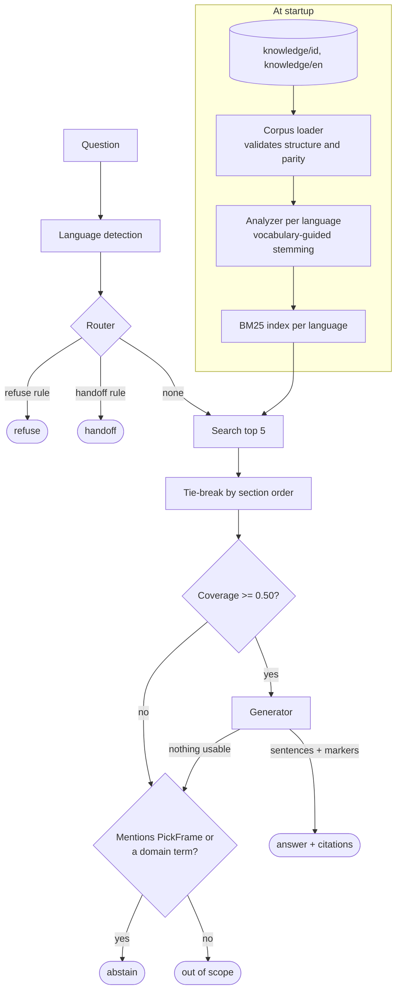

# Architecture

Everything runs in one process with no network and no runtime dependencies. A question goes through four stages, and each stage records what it did in a `Trace` that the CLI and the report show.

## Modules

| Module             | Responsibility                                                                                 |
| ------------------ | ---------------------------------------------------------------------------------------------- |
| `knowledge.py`     | Reads the markdown files into `Passage` objects and refuses a malformed or lopsided knowledge base |
| `text.py`          | Normalising, number canonicalisation, language detection, concepts, stemming, sentence splitting |
| `bm25.py`          | The ranking function and nothing else                                                          |
| `router.py`        | Named refuse and handoff rules                                                                 |
| `assistant.py`     | The pipeline above and the fixed reply texts                                                   |
| `generate.py`      | The `Generator` protocol and the extractive generator                                          |
| `llm.py`           | The optional OpenAI-compatible generator, standard library only                                |
| `cli.py`           | `ask`, `eval`, `check`                                                                         |
| `evaluation/`      | Cases, scoring, reference systems, regression gate, report                                     |

## Knowledge base

`knowledge/<lang>/<topic>.md`, one file per topic in each language, with the same topics and the same sections in both. A file has front matter (`id`, `title`, `lang`, `source`, `checked`) and `##` sections. Each section is one passage and is written so that its sentences make sense alone, because the generator quotes sentences, not passages. Passage ids look like `en/pricing#pro-plan-prices`. The loader fails with the file name when anything is missing, when a section is empty, or when the two languages disagree. See [knowledge authoring](knowledge-authoring.md).

## Retrieval

Each language has its own index, so a question is matched only against passages in its own language. Language is detected from function words, with a short list of common slang (`brp`, `gmn`, `gak`) expanded first; a tie goes to Indonesian, the site's default language.

The analyzer lowercases, drops apostrophes, treats `69.000` and `69,000` as the same number, merges a few two-word phrases (`berapa lama`, `how long`, `money back`) into one concept, drops stop words, then maps words to shared concepts: `harga`, `price` and `prices` all become `@price`. Words that are not concepts are stemmed. English uses a small suffix rule. Indonesian stemming is guided by the knowledge base's own words: a candidate stem is accepted only if it is a word of the knowledge base, or a word the knowledge base could be reduced to. That is how `dikembalikan` and `mengembalikan` meet at `kembali` without a general dictionary, and how `select` avoids becoming `lect`.

BM25 uses `k1 = 1.5`, `b = 0.75`. A term the corpus has never seen gets the highest idf, so a rare word in a question counts for a lot. Passages are indexed as heading, heading, title, body: the heading says what a passage is about, so it counts twice. Scores within 5% of the best are treated as ties and go to the earlier section, which by convention is the topic's overview.

## The decision to answer

Retrieval always returns something, so retrieval alone cannot say whether the knowledge base actually knows the answer. The assistant computes **coverage**: the idf-weighted share of the question's terms that appear in the passages it would use (those scoring at least half of the best, up to three). A number the knowledge base never mentions weighs a quarter, because it is usually a claim in the question rather than a missing topic. Below 0.50 the assistant declines.

A declined question is `abstain` if it mentions PickFrame or contains a PickFrame vocabulary term, and `out_of_scope` otherwise. This is the weakest rule in the system: "who won the football match last night" is declined as `abstain` because "last night" maps to the duration concept. It is one of the documented failures.

## Generation

The extractive generator quotes. It builds one candidate per sentence of the passages it is given and repeatedly adds the sentence that covers the most still-missing weight of the question, up to four. Terms that only a sentence's heading names count at 40%, so a section titled "Pro plan limits" can answer "how many projects does Pro have" with a sentence that never says "Pro". Passages other than the best one contribute only when they are nearly as relevant. The output is sentences followed by `[n]` for the passage each came from.

Any generator that implements `generate(request) -> Generated | None` can be plugged in. The optional LLM generator receives the same passages and is told to cite them or reply `NO_ANSWER`. A reply that cites nothing, or only passages it was not given, is treated as no answer. The evaluation then checks its numbers and sentences against the citations like any other system's.

## Failure handling

| Situation                                      | Behaviour                                                              |
| ---------------------------------------------- | ---------------------------------------------------------------------- |
| Knowledge base missing, malformed or lopsided   | `KnowledgeError` with the file; the CLI prints `error:` and exits 2    |
| Empty or symbol-only question                   | `out_of_scope`, trace says "nothing matched"                           |
| LLM endpoint unreachable or malformed reply     | `LLMError`; nothing is guessed                                         |
| A label points at a fact that is not in its topic | `check` and `eval` stop before scoring, naming the case              |

## Determinism

There is no randomness and no clock in any decision, so the same question always gets the same answer and a score change is always real. Latency is measured but never gated.
